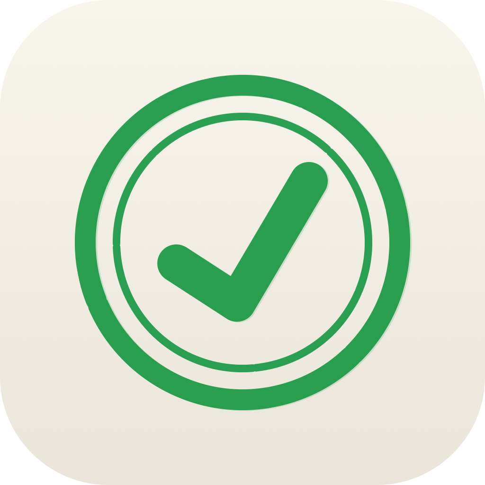
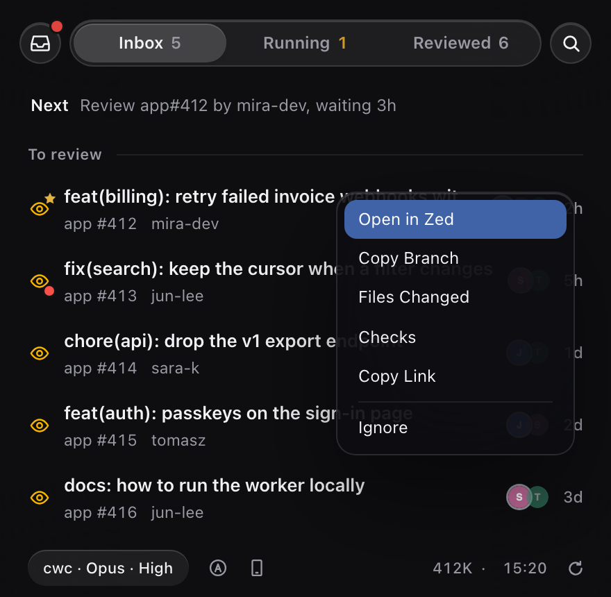
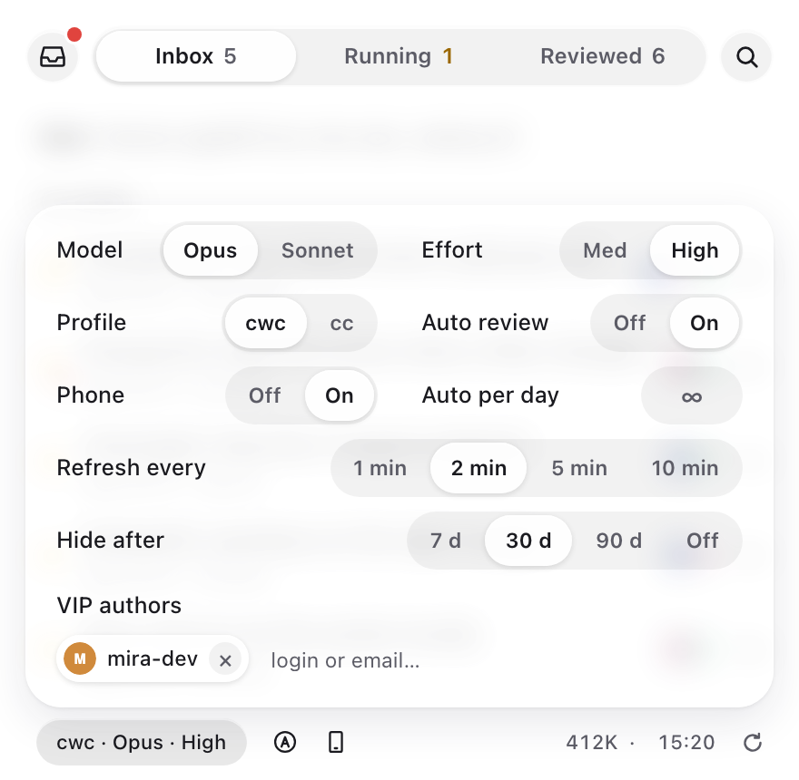
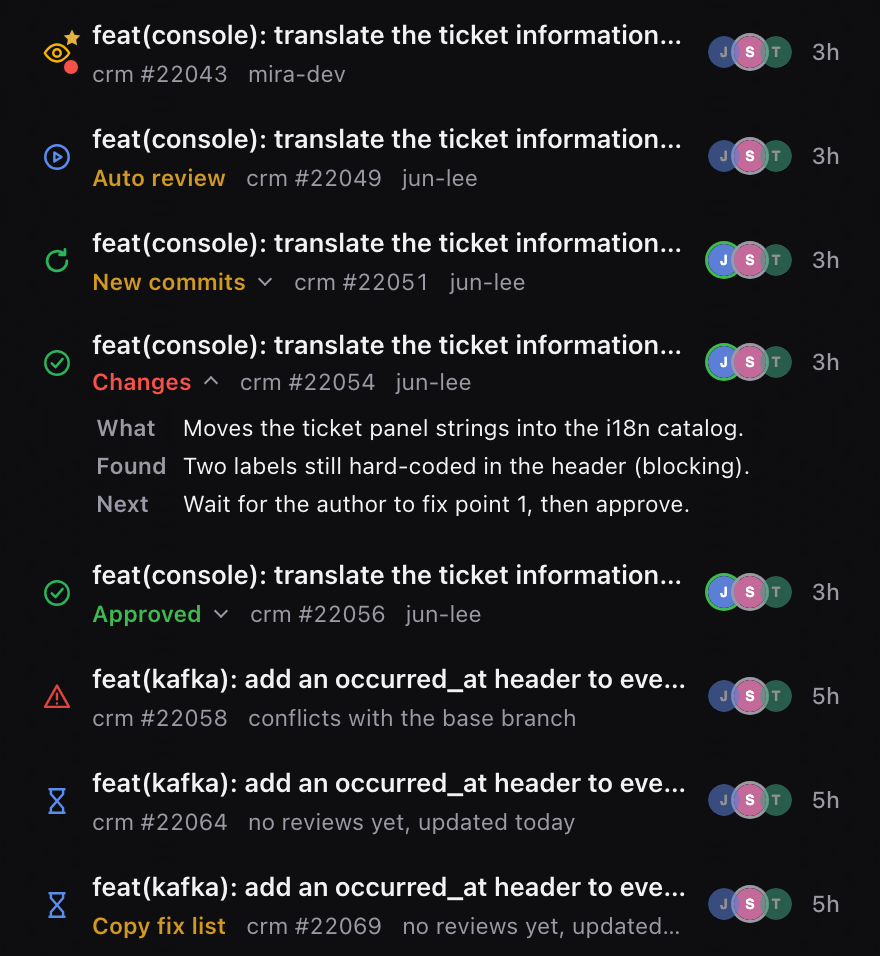

<p align="center">
  
</p>

<h1 align="center">Sidak</h1>

<p align="center">
  Surprise inspection for your PR queue.<br>
  A menu-bar board that sends Claude Code to review a pull request on your behalf, in a terminal you can watch.
</p>

<p align="center">
  
  
</p>

Sidak (Indonesian: *inspeksi mendadak*, a surprise inspection) lists the pull requests waiting on you. One click starts
a Claude Code review of a PR in a visible cmux terminal, with your own review memory and checklist, so you can watch it
work and steer it. The review lands on GitHub as an ordinary pull-request review; nothing else is left on the PR.

## What you get

- **Next** line on top: the Inbox PR waiting on you longest (VIPs first), else your own PR that needs you most. A tap opens it.
- **Approve** on a PR Claude reviewed with comments only (it approves by itself when it has nothing to say): one tap, asked
  first, posts your approval.
- **Ask Claude** about a review (right-click, or the phone's card sheet): Claude reads its own notes, its posted review and the
  PR in a background cmux tab, and the short answer shows on the card's sheet. Nothing is posted.
- **Review history** in the card's sheet: each of Claude's runs on the PR (when, Skim or Deep, what it posted, the head it read),
  and whether new commits came since.
- **Reviewer load** over your Waiting tab: whom your open PRs wait on, most first, so you know whom to nudge.
- **This week** (the calendar button by the sync time): the week's reviews, what they caught, your self-checks, tokens and
  Auto's share, the Inbox PRs waiting on you longest, and what Auto did: each review and fix it started, what a fix pushed,
  and each CI rerun.
- **Learns from your corrections**: when you delete or reword one of Claude's inline comments after a review posts, the board
  notices within the hour (for a week) and the next reviews get it as taste: no points like the deleted ones, phrasing like yours.
  The same goes for the author's pushback: a thread they answered and resolved with the code unchanged becomes a point not to make.
- **Stacks**: your stacked PRs (each based on the branch of the one below) show as one group under the bottom PR's tab, joined by
  a line; **Merge stack** merges them all through GitHub's stacked merge once every part is approved and green.
- **Quiet hours**: Auto starts nothing at night (22:00–08:00), or nights and weekends; what waits starts when they end.
- **Overdue**: an Inbox PR waiting on you over a day opens its meta line with the wait in amber, and the Next line counts them.
- **Smart depth**: Auto picks Deep instead of a Skim for a risky PR: one that touches a migration, auth or security code, or the
  feature flags, or changes more than 500 lines.
- **Auto self-checks your own PRs first**: with Auto on, each PR you open ready or move out of draft gets a quick self-check (its
  fix list) ahead of anyone else's review; approved ones are skipped. Push to it and, 10 quiet minutes later, Auto checks it
  again; Nudge waits for that fix list, so reviewers get a head your own check has read.
- **Auto fixes your own PRs**: with Auto on, a ready PR of yours whose checks fail, that conflicts with its base, or that has a change
  request waiting on you (quiet for an hour) gets `claude-fix` in a background cmux tab: it fixes, pushes, replies on the threads
  and re-requests review. Once per head commit, at most three times per PR (`autofix.json`).
  A failure that is the CI's own fault (a lost runner, a timeout, a full disk) gets its failed jobs rerun first, once per head
  commit, at no token cost; claude-fix sees it only if it fails again.
- **Stacks follow through**: when the PR under one of yours merges and GitHub retargets yours onto main, Auto rebases yours
  without the merged PR's commits (in a detached worktree) and force-pushes with a lease; a conflict goes to `claude-fix`.
- **Approved PRs stay current**: an approved PR of yours that falls behind a base requiring up-to-date branches gets GitHub's
  update-branch once its checks are done.
- **Fixed** on your own card: `claude-fix`'s summary (Done, Left, Failing), so you know what it did after its tab closed.
- **Merged branches go**: the local branch (and worktrees) of each PR of yours merged in the last 14 days is deleted, only when its
  tip is the merged head or behind it, every worktree on it is clean and unused for an hour, and your checkout is not on it.
- **Finished tabs close**: a review or fix tab whose run ended closes about 10 minutes later, unless it is the tab you have
  selected or pinned.
- **Self-check on your own PRs**: Skim / Deep there post nothing; the review is written as a fix list to `reviews/<repo>-<n>.md`
  (deleted after a week). The card's **Copy fix list** copies its path to hand to Claude, and Fix reads it by itself.
- **Token use** in the footer: what today's reviews used (hover for cache reads), each card's run in its icon's tooltip, and
  `Auto 3/10` when Auto per day sets a daily limit (plain `Auto` without one).
- **Inbox, Running, Reviewed** tabs, and a second profile for your own PRs (To do with your drafts folded under it, Waiting, Ready) with
  Fix, Nudge, Merge and Mark ready actions.
- **Skim** (quick) or **Deep** (full) review per PR, with model and effort picked in the panel; re-review any time.
- **Follow-ups**: a reviewed PR comes back to the Inbox when its author pushes after your review or re-requests you; Reviewed
  keeps the ones waiting on their author. A card says why it is back (New commits, Re-requested you) or your verdict, and a tap on
  that word opens the review's TL;DR (what the PR does, what it found, what next).
- **Menu-bar gauge** that fills as the backlog gets reviewed, a finish notification with the verdict, a global shortcut
  (⌃⌥P), and a popover you can drag off into its own window.
- **Auto review**: opt-in, quick depth, every Inbox PR at once, VIP authors first, and a re-review of each PR that came back once it
  has been quiet for an hour; no daily limit unless Auto per day sets one.
- **Stale** PRs folded away, **VIP** authors pinned, **snooze** a card for a day, right-click for Open in Zed, Copy
  branch, Files changed, Checks, Copy link.
- Reviews stay silent for everyone else: no labels, no comments beyond the review itself.

Two front ends share one page:

- `manifest.json`, `panel.html`, `panel.js`, `pr.js`, `background.js`: a Chrome/Arc extension.
- `app/Sidak.swift`: a macOS menu-bar app that loads the same page in a popover, draws a battery-style gauge of the
  review backlog, posts a notification when a review finishes, and ticks the auto-review mode. `app/build.sh` builds it.

`bin/` holds the shell side, symlinked into `~/bin`:

- `ccreview-host`: native-messaging host the extension talks to.
- `claude-review-open`: turns `ccreview://`, `ccfix://`, `ccmerge://`, `ccnudge://`, `ccready://`, `ccapprove://`, `ccask://`,
  `ccopen://` and `ccset://` URLs into actions.
- `claude-review`: checks the PR out in a worktree and runs the review interactively.
- `claude-ask`: answers a question about a review in a cmux tab and stores the answer for the board.
- `pr-board`: the counts for the menu bar and the auto-review tick.

`config.json`, `state.json`, `settings.json`, `handoffs/`, `answers/`, `autofix.json`, `autolog.json` and `token.txt` are personal or live data and stay out of git.

## Reading the board

Each card's state is the icon on its left; hover it for the full text (who is awaited, what the review cost).

<p align="center"></p>

**Review cards** (Inbox, Running, Reviewed)

| | |
|---|---|
|  | Waiting for your review |
|  | Review running (`Auto review` in amber when Auto started it); a click opens its cmux tab |
|  | Review failed: the tab closed before a review posted; a click skims again |
|  | Back since your review: new commits, or you were re-requested; Auto re-reviews it after an hour of quiet |
|  | Reviewed; the word under the title is your verdict (Approved, Changes, Commented) and opens the TL;DR |

**Your own PRs** (To do, Waiting, Ready)

| | |
|---|---|
|  | Conflicts with the base branch |
|  | Checks failing |
|  | Changes asked |
|  | Open review threads |
|  | Approved, checks still running |
|  | Awaiting reviewers (Nudge re-requests them) |
|  | No reviewers yet: add some |
|  | Ready to merge |
|  | Draft |

**Badges on the icon**

| | |
|---|---|
|  | Top corner: a VIP author |
|  | Bottom corner: the PR's checks are failing |

**Footer**: the capsule is what a click runs with (profile · model · effort, a tap opens the settings), then these while on:

| | |
|---|---|
|  | Auto review is on (`Ⓐ 3/10` when Auto per day sets a limit) |
|  | Phone access is on |

On the right: today's review tokens (hover for cache reads) and the last sync. `?` on the board has the same legend and every key.

## Setup

Requirements: macOS, cmux, Claude Code, `gh` (logged in), `jq` and `swiftc` (Xcode command-line tools). Zed is optional
(Open in Zed).

```sh
git clone https://github.com/dezeto/sidak && cd sidak && ./install.sh
```

`install.sh` is safe to re-run. It creates `config.json` from `config.example.json` with your login from `gh`, links
`bin/*` into `~/bin`, registers the native-messaging host `com.sidak.host` for Arc, Chrome, Chromium and Dia, writes
`token.txt` from `gh auth token` and builds `Sidak.app`. It then prints the manual steps: load the folder as an unpacked
extension and put its id in `config.json`, and set the cmux socket password.

`config.json` holds everything personal:

- `org`, `login`: the GitHub org whose PRs you review, and your login.
- `repos`: the folder that holds your `<repo>` checkouts (`~` allowed).
- `reviewable`: the repo names the board offers reviews for; the first is the default for a bare PR number.
- `rulesRepo`: a repo whose Claude memory every review loads, or `""`.
- `profiles`, `defaultProfile`: Claude profile name to `CLAUDE_CONFIG_DIR` (`""` is the default `~/.claude`).
- `extensionId`: the unpacked extension's id, for the native-messaging host.
- `remote` (optional): phone access, see below.

`node check.js` is the self-test; it prints `ok`.

## Phone

The board works from a phone through a Cloudflare Tunnel, actions included: the tabs float at the bottom in thumb reach, cards are compact rows,
and a tap on one opens its sheet (TL;DR, Open PR, Skim / Deep or Fix / Nudge / Merge, Copy, Ignore), a tap on a status icon says what it means, a sideways swipe changes
tab, and reviews still open in cmux on the Mac. In Safari, Share > Add to Home Screen makes it a full-screen Sidak app. There, Settings > Board > Home Screen badge puts the Inbox count on its icon. Sidak.app serves the board on `127.0.0.1` only and runs `cloudflared`, which lets a request through only with a
valid Cloudflare Access login.

1. In Cloudflare Zero Trust, add a self-hosted Access application for your hostname with an Allow policy for your email, and add
   One-time PIN under Integrations > Identity providers, so the login is a code sent to that email.
2. Add to `config.json`, with the team name (`<team>.cloudflareaccess.com`) and the app's Application Audience (AUD) tag:
   ```json
   "remote": { "hostname": "sidak.example.dev", "port": 8787, "tunnel": "sidak", "team": "<team>", "aud": "<aud tag>" }
   ```
3. Run `./install.sh`: it creates the tunnel and its DNS record, and Sidak.app restarts with the tunnel up.

Phone in the settings card switches the tunnel off and on. Without `team` and `aud` the server runs but the tunnel stays off. The tunnel log is `~/Library/Logs/Sidak-tunnel.log`.
