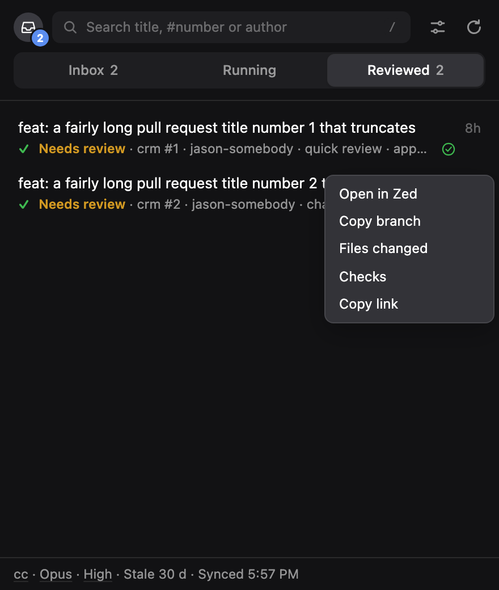
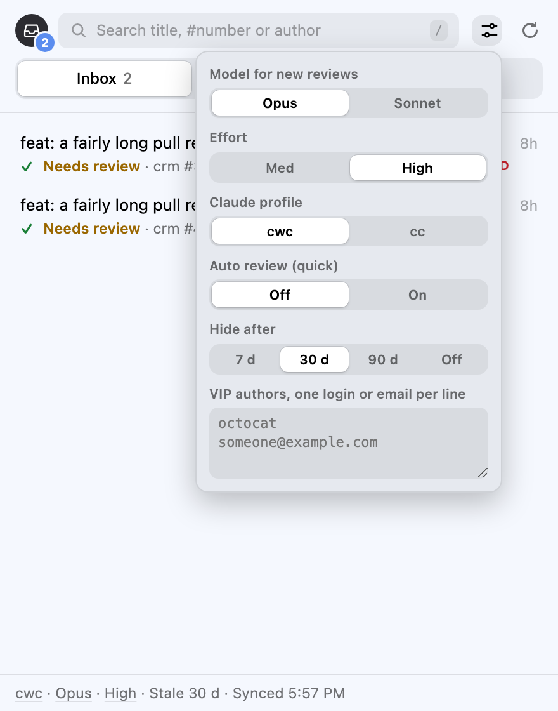

<p align="center">
  
</p>

<h1 align="center">Sidak</h1>

<p align="center">
  Surprise inspection for your PR queue.<br>
  A menu-bar board that sends Claude Code to review a pull request on your behalf, in a terminal you can watch.
</p>

<p align="center">
  
  
</p>

Sidak (Indonesian: *inspeksi mendadak*, a surprise inspection) lists the pull requests waiting on you. One click starts
a Claude Code review of a PR in a visible cmux terminal, with your own review memory and checklist, so you can watch it
work and steer it. The review lands on GitHub as an ordinary pull-request review; nothing else is left on the PR.

## What you get

- **Inbox, Running, Reviewed** tabs, and a second profile for your own PRs (Needs me, Waiting, Ready, Drafts) with
  Fix, Nudge, Merge and Mark ready actions.
- **Skim** (quick) or **Deep** (full) review per PR, with model and effort picked in the panel; re-review any time.
- **Menu-bar gauge** that fills as the backlog gets reviewed, a finish notification with the verdict, a global shortcut
  (⌃⌥P), and a popover you can drag off into its own window.
- **Auto review**: opt-in, quick depth, one at a time, VIP authors first, at most ten a day.
- **Stale** PRs folded away, **VIP** authors pinned, **snooze** a card for a day, right-click for Open in Zed, Copy
  branch, Files changed, Checks, Copy link.
- Reviews stay silent for everyone else: no labels, no comments beyond the review itself.

Two front ends share one page:

- `manifest.json`, `panel.html`, `panel.js`, `pr.js`, `background.js`: a Chrome/Arc extension.
- `app/Sidak.swift`: a macOS menu-bar app that loads the same page in a popover, draws a battery-style gauge of the
  review backlog, posts a notification when a review finishes, and ticks the auto-review mode. `app/build.sh` builds it.

`bin/` holds the shell side, symlinked into `~/bin`:

- `ccreview-host`: native-messaging host the extension talks to.
- `claude-review-open`: turns `ccreview://`, `ccfix://`, `ccmerge://`, `ccnudge://`, `ccready://`, `ccopen://` and
  `ccset://` URLs into actions.
- `claude-review`: checks the PR out in a worktree and runs the review interactively.
- `pr-board`: the counts for the menu bar and the auto-review tick.

`config.json`, `state.json`, `settings.json`, `handoffs/` and `token.txt` are personal or live data and stay out of git.

## Setup

Requirements: macOS, cmux, Claude Code, `gh` (logged in), `jq` and `swiftc` (Xcode command-line tools). Zed is optional
(Open in Zed).

```sh
git clone https://github.com/dezeto/sidak && cd sidak && ./install.sh
```

`install.sh` is safe to re-run. It creates `config.json` from `config.example.json` with your login from `gh`, links
`bin/*` into `~/bin`, registers the native-messaging host `com.sidak.host` for Arc, Chrome, Chromium and Dia, writes
`token.txt` from `gh auth token` and builds `Sidak.app`. It then prints the manual steps: load the folder as an unpacked
extension and put its id in `config.json`, and set the cmux socket password.

`config.json` holds everything personal:

- `org`, `login`: the GitHub org whose PRs you review, and your login.
- `repos`: the folder that holds your `<repo>` checkouts (`~` allowed).
- `reviewable`: the repo names the board offers reviews for; the first is the default for a bare PR number.
- `rulesRepo`: a repo whose Claude memory every review loads, or `""`.
- `profiles`, `defaultProfile`: Claude profile name to `CLAUDE_CONFIG_DIR` (`""` is the default `~/.claude`).
- `extensionId`: the unpacked extension's id, for the native-messaging host.

`node check.js` is the self-test; it prints `ok`.
